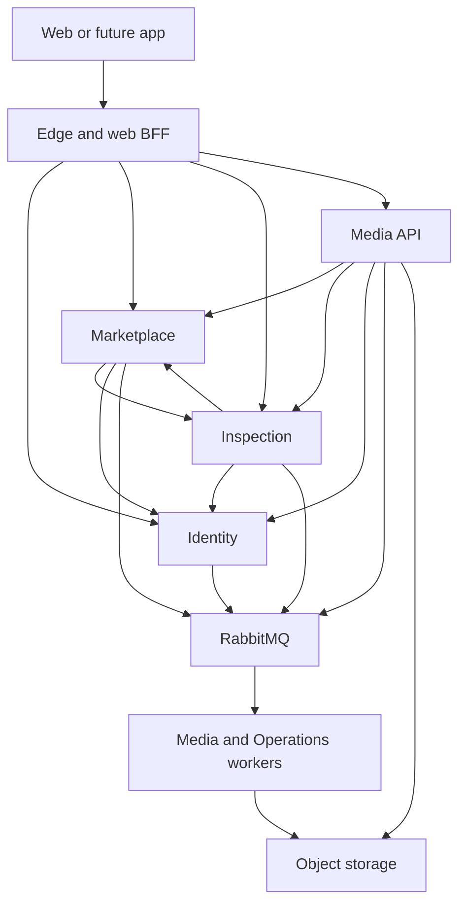

# Microservice Architecture

## Service ownership

| Unit | Owns | Database | Independent scaling trigger |
|---|---|---|---|
| Identity | Credentials, verification, staff grants, MFA, sessions, security audit | identity | Auth latency and bounded hash-pool wait |
| Marketplace | Ads/revisions, catalog, profile display, moderation, contact, favorites, shop business config | marketplace | Read traffic or indexed-query latency |
| Inspection | Slots, reservations, checklist versions, private identifiers, reports, fees/acknowledgement | inspection | Booking/report workload |
| Media | Upload tickets, immutable variants, evidence files, processing and deletion jobs | media | Queue age and conversion CPU/memory |
| Operations worker | Notification inbox/delivery, deduplicated audit projection | operations | Notification queue age |
| Web BFF/gateway | Page rendering, cookie forwarding, service composition and public routing | No domain DB | Rendering/request volume |

All services have per-service credentials, DB roles and deployment pipelines. One cluster may host separate logical databases during pilot; this saves baseline cost but shares a failure domain. Split clusters later without changing ownership contracts. No cross-database joins, tables or foreign keys.

## Runtime topology

Each service additionally uses only its own database. Service call relationships are specific use cases, not unrestricted cycles. For example Marketplace public summary asks Inspection only for report metadata; Inspection issuance asks a Marketplace snapshot endpoint which must not call back into Inspection. Bound this graph by dedicated lightweight endpoints.

## Communication and trust

- HTTPS external; TLS on private service connections and broker. Only edge/web public. Databases, broker, telemetry admin and service APIs stay private.
- Workload identity or rotated service credentials restrict caller scopes. Never trust user/role headers from the public internet. Gateway removes them.
- Identity issues short-lived audience-scoped assertions only after validating current session. Services verify signature, issuer, audience, expiry and permitted operation. Sensitive staff actions additionally introspect live grants/MFA/session status.
- Service credentials authenticate the caller, not the delegated user. Authorization must evaluate both workload scope and actor rights/object ownership.
- REST for current decisions; RabbitMQ for media work, notifications, account projection, audit aggregation and cache invalidation. No large images or passwords in events.
- Start with per-call timeout 1 s (public report summary target 300 ms), no more than one retry for safe reads, jittered retries and circuit breakers. Sensitive dependency failure returns a safe denied/unavailable result.

## Reliable event delivery

Write domain mutation + local audit + outbox event in one local transaction. A publisher claims outbox records, sends persistent messages with publisher confirms and marks sent only after confirmation. Consumers insert an inbox key and domain changes in one transaction, then ack. Delivery is at least once: duplicates are expected. Do not claim exactly once or use broker acknowledgements as evidence of a committed business operation.

Event envelope includes event_id, type/schema_version, occurred_at, aggregate_id, aggregate_version, producer, traceparent and minimal payload. Consumers ignore older aggregate versions; if sequence gaps matter, refetch authoritative state. Poison messages route to a DLQ with sanitized error and original event ID. Replay after fix must remain idempotent.

## Consistency rules

### Current inspection badge

1. Marketplace reads current listing row and device_revision (fresh status).
2. Inspection bulk-summary endpoint returns report state/revision/valid_until from its primary database, not an async projection.
3. Marketplace computes eligibility only when listing published/unexpired, report published/unrevoked/unexpired and revisions match.
4. On Inspection timeout, return `inspection_state=unavailable` without affirmative badge. For inspected-only results, exclude uncertain entries and show degraded count/message.
5. Cache base text/catalog if useful, but not affirmative eligibility or contact decisions. Inspected-only pagination evaluates candidate IDs in bounded batches; never present an exact eligible count from stale hints. If the scan budget is exhausted, return a cursor/degraded result indication. Events update search hints only; they never grant trust.

Fresh-read guarantee refers to committed changes before the authoritative read. Concurrent changes after that read can happen. UI refreshes on focus/30 s; contact rechecks listing at action time. There is no distributed atomic snapshot across services or guarantee that an already displayed page updates instantly.

### Report issuance

Inspection obtains current seller/listing/device_revision snapshot from Marketplace without trusting stale projected state. It validates exact draft acknowledgement revision, checks/identity match, distinct approver and fee. It commits published report, completes the request and supersedes prior report locally in one transaction. A racing later listing edit may make that report ineligible; read-time revision matching prevents a false badge. A public report page also reads the current Marketplace snapshot and separates immutable findings from present listing eligibility; if that read fails, it shows unavailable eligibility. No two-phase commit is needed. Do not silently rewrite the inspected revision to the new listing revision.

### Slots and bookings

Inspection owns both slot and request. A locked slot row + partial unique reservation constraint creates the reservation in one transaction. Idempotency record in the same database returns the original result. Cancellation releases occupancy through status changes, not deletion.

### Media linking

Media owns bytes; Marketplace/Inspection own attachment relationships. Media-ready events only indicate conversion completed. Owner services verify asset owner/purpose/target and choose moderation/publication. Failed event delivery is repaired by pending-state reconciliation. A ready file cannot attach itself to another user's listing.

### Account suspension and role removal

Identity immediately revokes sessions and updates authz_version. Domain services use short token lifetime for ordinary reads; contact/posting/private reads and all staff changes require live Identity permission check. Suspension blocks writes/contact even before async profile projection updates. Broker lag never enables privileges.

## Failure isolation

| Failure | Required outcome |
|---|---|
| Image worker/broker down | Upload processing queues/pause under pressure; browse existing ads continues |
| Inspection down | Browse uninspected ads; report unavailable; no affirmative badge; booking unavailable |
| Identity down | Public browse works; sensitive/contact/authenticated operations fail closed |
| Notification provider down | Core action committed with local notification/outbox; retries; UI shows delivery state |
| Telemetry backend down | Bounded local buffer; no request crashes; local security audit still persisted |
| Domain DB/audit transaction fails | Privileged mutation rolls back; no unaudited success |
| Object storage down | Existing CDN objects may load; new upload/evidence unavailable; no false ready state |

## Scaling and maintenance

Add replicas to stateless API units based on measured saturation; cap DB connections. Scale Media separately using queue age and hard limits. Initially one broker/cluster may be a pilot dependency, not HA. HA requires appropriate multi-node broker, database failover and replicated edge/app placement; containers alone do not provide it.

Monorepo shared contracts ease changes but do not require all-service deployment. Compatible additive event/API evolution comes first; breaking changes use new versions and overlapping support. Architecture changes need an ADR with trigger, impact, migration and rollback. See decisions-sources.md.

## Clerical report corrections

A correction request references the original report and preserves the original observation date, identifiers and frozen evidence. It may correct clerical text using original evidence; new physical-condition claims or a newer eligibility window require a new physical inspection. Correction cannot bypass seller acknowledgement, distinct approver, current listing revision or fee policy. The new report links/supersedes the old one; the old report remains accessible as revoked.
