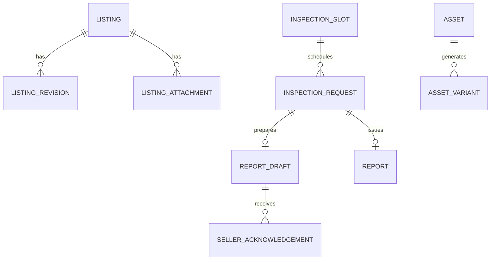

# Database Schema Specification

This is a typed logical schema for implementation migrations, not executable SQL. FK means a constraint within the same service database. REF means an external service ID validated through API/event logic, with no cross-service database constraint.

## Shared conventions

UUID IDs; timestamptz UTC; shop display Asia/Karachi; integer PKR for MVP money; CHECK nonnegative amounts; fixed allowed status values; mutable rows have created_at, updated_at and version bigint ≥1. Text lengths are enforced in DTOs and DB where practical. JSONB is for versioned snapshots/check definitions, not replacements for indexed relational columns.

Security-sensitive ciphertext stores key_id, nonce and authentication tag with authenticated encryption. Search/match digests use a separately keyed HMAC. Hash/token digests are not plaintext credentials. Store derived values only when there is a clear query or integrity need.

## Identity database

| Table | Columns and constraints |
|---|---|
| accounts | id UUID PK; realm text public/staff; email_normalized varchar(254); display_name varchar(100); status pending/active/suspended/deleted; email_verified_at timestamptz nullable; authz_version bigint; deleted_at nullable; UQ(realm,email_normalized) |
| password_credentials | account_id PK FK accounts; password_hash text PHC Argon2id; changed_at timestamptz; hash_policy_version int; must_change bool. No raw salt column necessary with PHC encoding |
| phones | id PK; account_id FK; phone_e164 varchar(20) UQ for active verified registrations; verified_at nullable; is_primary bool; changed_at. Resolve number recycling/account recovery through policy, not automatic transfer |
| verification_challenges | id PK; account_id FK nullable; purpose email_verify/phone_verify; target_ciphertext bytea; secret_digest bytea; expires_at; attempts int; consumed_at nullable. Short OTP uses keyed HMAC to resist offline enumeration |
| reset_tokens | id PK; account_id FK; token_digest bytea UQ; expires_at; used_at nullable; requested_at; realm. High entropy token, single use |
| sessions | id PK; account_id FK; realm; session_digest bytea UQ; family_id UUID; expires_at; idle_expires_at; revoked_at nullable; mfa_completed_at nullable; authz_version; user_agent_summary; ip_signal_digest nullable |
| refresh_tokens | id PK; session_id FK; token_digest UQ; parent_id FK self nullable; issued_at; expires_at; used_at; revoked_at. Native app extension; rotation/reuse detection |
| mfa_factors | id PK; account_id FK; type totp; secret_ciphertext bytea; key_id; enabled_at; last_accepted_time_step bigint; pending_expires_at nullable |
| recovery_codes | id PK; account_id FK; code_digest bytea UQ; consumed_at nullable. Display once |
| staff_invitations | id PK; email_normalized; inviter_id FK accounts; grant_snapshot JSONB; token_digest UQ; expires_at; accepted_at nullable; revoked_at nullable |
| staff_grants | id PK; account_id FK; shop_id UUID REF; role owner/admin/inspector/moderator; permissions JSONB allowlisted; active bool; granted_by FK; revoked_at; UQ(account_id,shop_id,role) |
| service_clients | id PK; name UQ; credential_digest/key_reference; allowed_scopes JSONB; active; rotated_at. Deployment identity may replace this table |
| linked_identities | public_account_id FK accounts; staff_account_id FK accounts; verification_method; linked_at; composite PK(public_account_id,staff_account_id). Trusted verified link only; same email alone is not proof |

Signup creates only realm=public. Staff activation creates realm=staff from invitation; role assignment is never taken from a signup form. Use a partial index to ensure one primary active verified phone per account. Prevent last-owner deletion with a transactional lock and active-owner count.

## Marketplace database

| Table | Columns and constraints |
|---|---|
| shops | id PK; name varchar(100); slug UQ; address; city_id FK; timezone; phone; hours JSONB; listing_ttl_days int CHECK 1–365; inspection_validity_days int CHECK 1–90; inspection_fee_pkr int CHECK ≥0; policy_version |
| account_profiles | account_id UUID PK REF Identity; display_name; public_seller_type private/shop; account_status_projection; projection_version; contact_consent_at; phone_last_verified_projection. Projection is not write authorization |
| cities | id PK; name varchar(100); country_code char(2); UQ(name,country_code) |
| areas | id PK; city_id FK; name; UQ(city_id,name); UQ(id,city_id) for composite consistency |
| brands | id PK; name UQ; active bool |
| phone_models | id PK; brand_id FK; name; capabilities JSONB; active; UQ(brand_id,name) |
| model_storage_options | model_id FK; storage_gb int CHECK >0; composite PK(model_id,storage_gb) |
| listings | id PK; shop_id FK; seller_account_id REF; model_id FK; storage_gb; city_id FK; area_id nullable; slug UQ; color; condition; price_pkr int CHECK >0; pta_claim approved/not_approved/unknown; battery_claim_percent int nullable CHECK 0–100; repair_disclosure; defects; accessories JSONB; description; seller_type; contact_modes JSONB; status; device_revision bigint; revision_no bigint; published_at; expires_at; sold_at. FK(model_id,storage_gb) storage options; FK(area_id,city_id) areas |
| listing_contacts | listing_id PK FK; verified_phone_id UUID REF Identity; phone_ciphertext bytea; key_id; verified_at; public_share_consent_at; revoked_at. Never serialize into public listing DTO |
| listing_revisions | id PK; listing_id FK; revision_no; device_revision; snapshot JSONB; actor_account_id REF; reason; created_at; UQ(listing_id,revision_no). Exclude private identifiers/secrets from snapshot |
| listing_attachments | id PK; listing_id FK; media_asset_id UUID REF; device_revision; sort_order smallint CHECK 0–7; approval_state pending/approved/rejected; media_generation; UQ(listing_id,device_revision,sort_order); UQ(listing_id,device_revision,media_asset_id) |
| moderation_decisions | id PK; listing_id FK; revision_id FK; reviewer_account_id REF; decision; reason; created_at. Validate revision belongs to listing within transaction |
| favorites | account_id REF; listing_id FK; created_at; PK(account_id,listing_id) |
| contact_events | id PK; listing_id FK; viewer_account_id REF nullable; request_key UUID UQ; action call/whatsapp; dedupe_signal_digest nullable; occurred_at. No raw phone or message content |
| abuse_reports | id PK; listing_id FK; reporter_account_id REF nullable; reason; details; status open/in_review/resolved; assigned_to REF nullable; resolution; resolved_at |
| inspection_hints | listing_id PK FK; report_id REF; projected_revision; projected_state; aggregate_version; observed_at. Search accelerator only; not authoritative badge |

Index listings(status,city_id,published_at DESC,id), listings(model_id,status,price_pkr,id), and relevant storage/condition paths after EXPLAIN evidence. Expiry must be checked by time on read, not dependent on scheduled state changes. Enforce publication gates transactionally; current revision only.

## Inspection database

| Table | Columns and constraints |
|---|---|
| shop_policy_snapshots | shop_id UUID PK REF; policy_version; fee_pkr; validity_days; timezone; projection_version; fetched_at. Issuance captures accepted policy |
| inspection_slots | id PK; shop_id REF; inspector_account_id REF nullable; starts_at; ends_at CHECK >starts_at; capacity smallint CHECK =1 for MVP; state available/blocked/cancelled |
| inspection_requests | id PK; listing_id REF; seller_account_id REF; slot_id FK nullable; inspector_account_id REF nullable; status requested/booked/checked_in/in_progress/awaiting_acknowledgement/pending_approval/completed/declined/cancelled/no_show; inspected_device_revision; requested_at; checked_in_at; request_kind physical_inspection/correction; corrects_report_id FK reports nullable; cancellation_reason; fee_due_pkr CHECK ≥0; fee_received_pkr CHECK ≥0; fee_status unpaid/paid/waived; fee_recorded_by REF nullable; paid_at; policy_version |
| device_identifiers | id PK; request_id FK; type imei/serial; identifier_slot smallint; ciphertext bytea; key_id; keyed_lookup_digest bytea; UQ(request_id,type,identifier_slot). HMAC index for private duplicate review; never public |
| checklist_versions | id PK; version int UQ; definition JSONB; created_at. Immutable once referenced |
| report_drafts | id PK; request_id FK UQ; draft_revision bigint; status in_progress/awaiting_acknowledgement/pending_approval/issued/rejected; checklist_version_id FK; summary; limitations; identity_match bool; evidence_summary JSONB; updated_by REF |
| draft_items | id PK; draft_id FK; item_key; result pass/fail/not_tested/not_applicable; observed_value JSONB; notes; source observed/declared; visibility public/private; UQ(draft_id,item_key) |
| seller_acknowledgements | id PK; draft_id FK; draft_revision; seller_account_id REF; findings_digest bytea; acknowledged_at; UQ(draft_id,draft_revision). Any findings change requires fresh acknowledgement |
| reports | id PK; request_id FK; listing_id REF; public_code varchar(40) UQ; inspector_account_id REF; approver_account_id REF; checklist_version_id FK; inspected_device_revision; findings_snapshot JSONB; public_summary; limitations; status published/revoked; inspected_at; valid_until CHECK >inspected_at; published_at; revoked_at; reason; supersedes_report_id FK self nullable; ack_id FK; fee_snapshot JSONB; CHECK(inspector_account_id<>approver_account_id) |
| report_evidence_links | id PK; request_id FK; draft_id FK nullable; report_id FK nullable; media_asset_id REF; item_key nullable; visibility public/private default private. Validate request linkage; no public evidence unless explicitly approved |
| report_actions | id PK; report_id FK; actor_account_id REF; action publish/revoke/supersede; reason; created_at. Append only |

Partial unique indexes:
- inspection_requests(listing_id) WHERE status IN (requested,booked,checked_in,in_progress,awaiting_acknowledgement,pending_approval).
- inspection_requests(slot_id) WHERE slot_id IS NOT NULL AND status IN (booked,checked_in,in_progress,awaiting_acknowledgement,pending_approval). Occupancy releases at completed/cancelled/declined/no_show; long report approval should not block later time slots because slots are distinct.
- reports(listing_id) WHERE status='published'. Expired published reports must be revoked/superseded when replacing so this invariant remains useful. UQ(request_id) allows one issued report per physical inspection request; corrections use a new request explicitly classified as correction and linked to the previous report, with no fabricated reinspection date.

Appointments for the same inspector cannot overlap: use a range exclusion constraint for available assigned slots or a serialized scheduling operation covering [starts_at,ends_at). Booking and slot blocking share the same row lock. Time-based expiry is never embedded in an index predicate using volatile now().

## Media database

| Table | Columns and constraints |
|---|---|
| upload_tickets | id PK; owner_account_id REF; purpose listing/evidence; target_id REF; original_object_key UQ; content_type; expected_size_bytes bigint; checksum nullable; pinned_storage_version nullable; status issued/uploaded/consumed/expired; expires_at; consumed_at; created_at |
| assets | id PK; owner_account_id REF; purpose; target_id REF; upload_ticket_id FK UQ; status quarantined/processing/ready/failed/rejected/deleting/deleted; generation int; original_checksum; processing_policy_version; visibility private/public_candidate; error_code nullable; ready_at; deletion_requested_at |
| asset_variants | id PK; asset_id FK; generation; name thumb/card/detail/evidence; object_key UQ; mime_type CHECK='image/webp'; width int; height int; size_bytes bigint; checksum; created_at; UQ(asset_id,generation,name) |
| processing_jobs | id PK; asset_id FK; generation; status queued/running/succeeded/failed/dead; attempts int; available_at; started_at; finished_at; trace_id; last_error_code; UQ(asset_id,generation) |
| asset_access_grants | id PK; asset_id FK; requested_by REF; purpose; expires_at; created_at. Optional evidence download audit linkage, not public access authority |
| deletion_jobs | id PK; asset_id FK; reason; status; attempts; next_attempt_at; completed_at; UQ(asset_id) |

Object bytes remain outside these tables. Never store a signed URL as a durable reference; derive it after permission checks from immutable object key and generation. Raw original is quarantined and deleted after successful conversion under retention policy. Private inspection evidence follows its separate retention/hold policy.

## Operations database

| Table | Columns and constraints |
|---|---|
| notifications | id PK; recipient_account_id REF; source_event_id UUID; type; safe_payload JSONB; read_at; created_at; UQ(recipient_account_id,source_event_id,type) |
| deliveries | id PK; notification_id FK; channel email/sms/in_app; provider_message_ref nullable; status queued/sending/sent/failed/dead; attempt_count; next_attempt_at; dedupe_key UQ |
| audit_projection | source_service + source_audit_id composite PK; actor_account_id REF nullable; action; entity_type/id; redacted_changes; request_id; trace_id; occurred_at; ingested_at |
| delivery_preferences | account_id PK REF; allowed_channels JSONB; updated_at. Security/transactional notices follow separate policy from marketing |

## Local reliability tables in each service database

| Table | Required fields |
|---|---|
| outbox | event_id UUID PK; aggregate_id; aggregate_version bigint; event_type; schema_version int; payload JSONB; traceparent; occurred_at; published_at nullable; attempts; next_attempt_at |
| inbox | consumer_name + event_id composite PK; processed_at; aggregate_version |
| idempotency_records | actor_id + operation + key composite PK; request_digest; state; result_reference/response; status_code; expires_at. Transactional with domain changes |
| audit_events | id PK; actor_id nullable; action; entity/id; redacted_changes JSONB; request_id; trace_id; created_at. No UPDATE/DELETE for application role |

## Relationship view

Listing IDs inside Inspection and asset IDs in attachments/evidence are references across services, deliberately absent from this local-FK diagram. Account references are always Identity IDs.

## Migrations and deletion

Service owns its migration history. Use expand → backfill → compatible rollout → contract; no automatic destructive migration at service startup. Test rollback compatibility with the previous app release. Index large tables concurrently where supported, with separate migration handling. Anonymize profiles and contact, revoke sessions, remove public assets and schedule evidence deletion absent a hold; preserve redacted report/audit lineage. Retention periods are proposed policies in auth-security.md, not a license to retain private data indefinitely.
