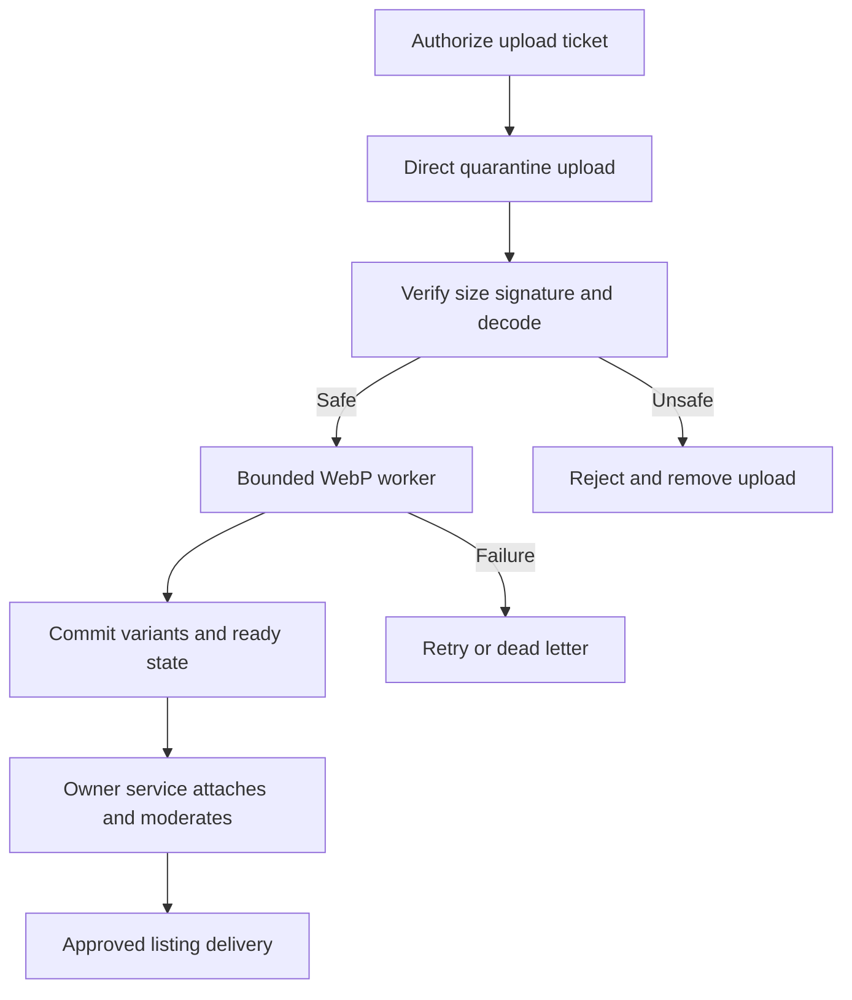

# Media Upload and WebP Pipeline

## Storage decision

Store WebP image bytes in object storage and database metadata in Media. Marketplace/Inspection store asset IDs and attachment relationships. This satisfies persistent image storage while avoiding large database blobs, base64 inflation and enlarged backups. Durable references are object keys/generations, never expiring signed URLs.

## Upload and conversion flow



1. Media validates actor, realm, purpose and target through Identity and owner service. Create 10-minute ticket with generated object key and size budget. User filename never controls path.
2. Browser uploads directly to quarantine using constrained storage policy (type/key/length limit if provider supports it). If provider cannot enforce length on upload, worker must verify stored size and delete violations; account quotas still apply.
3. Completion endpoint validates ticket ownership, single use, stored object version/key, byte size/checksum and exists. Pin the accepted immutable storage version; the worker reads exactly that version. If the provider lacks versioning, copy to a service-only immutable key before acknowledging completion, so a still-valid upload URL cannot replace queued bytes. It atomically records asset/job/outbox. Completion is not processing success.
4. Worker fetches only the allowed storage key, never a user-provided URL. Validates signature/decoded format, dimensions/pages and byte size. Isolate decoder, reject unsafe inputs and re-encode.
5. Generate deterministic variant keys from asset ID + generation + processing version. Write all required outputs, verify checksums, then transactionally record variants/status/outbox. A partial write never sets ready.
6. Owner service verifies target ownership/purpose/generation and processing state, attaches asset and performs moderation. Media readiness alone never makes a photo public.
7. Quarantine original removed ≤24 h after conversion success. Abandoned tickets/uploads removed after 24 h. Reprocessing after source deletion requires reupload; retain original longer only under explicit policy.

## Limits and quality defaults

| Rule | Proposed default |
|---|---|
| Input formats | JPEG, PNG, nonanimated WebP only; reject SVG/GIF/TIFF/remote URL and animated/multipage inputs |
| Per image | 5 MB compressed, ≤20 megapixels, ≤10,000px any edge, validate both before full decode |
| Per listing | 3–8 approved/current photos, uploading may temporarily stage replacements within account budget |
| Account budget | 100 MB/day and 20 new tickets/hour starting policy; staff evidence separately bounded |
| Thumb | Fit inside 160×160; WebP quality 75; target ≤20 KB |
| Card | Fit inside 640×480; quality 80; target ≤100 KB |
| Detail | Fit inside 1600×1600; quality 85; target ≤400 KB |
| Evidence | Up to 2000×2000, lossless WebP for important markings/text; private, no arbitrary forced compression |
| Concurrency | One job per worker initially, bounded native threads; do not start unbounded Promise.all conversion |
| Runtime | 20-second hard job budget, memory/CPU container limits; kill/retry process safely |

Byte targets are goals, not universal guarantees. Use bounded quality adjustment (e.g. quality 80 then 70 for card), never repeatedly compress without limit or erase defect detail. Do not upscale. Auto-orient before resizing and strip EXIF/GPS/XMP. Real phone photos retain their colors; monochrome is UI styling.

## Representative worker pseudocode

```typescript
// Specification only. Integrate with authorization, limits, job leases and storage adapter.
const image = sharp(quarantinePath, { limitInputPixels: 20_000_000 });
const metadata = await image.metadata();
assertAllowedFormatAndDimensions(metadata);
assertSingleFrame(metadata);
await image.rotate()
  .resize({ width: 640, height: 480, fit: 'inside', withoutEnlargement: true })
  .webp({ quality: 80, effort: 4 })
  .toFile(generatedTemporaryPath);
// Never call keepMetadata/withMetadata; upload only completed validated result.
```

Apply input pixel bound in decoder construction; metadata check alone does not prevent a decoder resource attack. Keep source path internal and generated. Decode execution must run inside the worker's enforced resource/time boundary. Sharp removal of metadata and WebP encoding support are documented in the references; this pseudocode is not a tested implementation.

## State model and retry

`quarantined → processing → ready` or `rejected/failed`. Retryable failures requeue with same asset/generation and up to three processing attempts; unsafe input is not retryable. After max attempts use `dead` job state, UI failed asset and DLQ alert. Ready output can later move deleting → deleted. Job lease/heartbeat ensures worker crash recovery; duplicates cannot overwrite newer generations.

Object upload and DB commit are not atomic. Worker retries reconcile existing complete variants; uncommitted orphan keys removed by a reconciler after safe grace period. Deletion of a target schedules cleanup, rechecks active references and holds, removes original/variants and marks tombstone only once storage deletion confirms. Processing checks deletion state before publish to prevent resurrecting deleted media.

## Public serving and revocation

Keep storage bucket private; deliver approved listing variants through an access-controlled media gateway/CDN path keyed by immutable asset/generation. Gate initial publication against authoritative Marketplace attachment/listing state. A CDN policy may cache approved public bytes for at most 60 seconds with purge on unpublish/deletion; already cached/copied public images cannot be recalled instantly. Trust badge and contact remain no-store/current and are never granted by an image response.

Private inspection evidence does not use public CDN cache. Require live permission + scoped short-lived storage access (initial 60 seconds). Signed links remain usable until expiry if copied; where immediate revoke is necessary, stream through an authorization-checking proxy instead. Never expose original quarantine URLs publicly.

## Evidence integrity

Private source evidence, when policy requires original capture, is retained separately under encryption and hold policy, with source checksum and access audit. Converted evidence uses lossless WebP and is a derivative; checksums prove byte stability, not truth of the original image. Public listing originals follow short retention. Staff must not upload gallery photos containing full identifiers; moderation should detect obvious exposed IMEI/serial screenshots and remove them.

## Testing and monitoring

Test false extension, bad magic, corrupt file, huge decoded dimensions, animation, EXIF orientation/GPS, valid variants, overwrite attempts, cross-user attachment, expired tickets, quota race, storage timeout, worker crash, duplicate delivery and delete-during-processing. Monitor queue age, job duration, error code, decoded-pixel count, memory peak, output bytes and retries without logging source image/identifier data.
